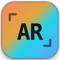

<div align="center">



<h1>André Ricco Terra</h1>

<b>Engenheiro de IA · Desenvolvedor Web Full Stack</b>
<br>
Campo Grande, MS · Brasil · Inglês avançado · Remoto ou híbrido

<br><br>

[](https://portfolioweb-andreterra.netlify.app/)
[](https://www.linkedin.com/in/andr%C3%A9-ricco-1674b8283/)
[](mailto:andre.terra16@gmail.com)

<br>


</div>

<br>

## Sobre

Minha base é engenharia: análise de projetos, planejamento e controle de produção (PCP) em operação industrial de corte e dobra, projetos mecânicos, elétricos e de construção civil, produzindo laudos e relatórios técnicos. Hoje aplico essa mesma lógica analítica ao desenvolvimento web, atuando como Desenvolvedor Web na Salomão Santos Consultoria e Tecnologia.

Construo produto de ponta a ponta: interface em React/Next.js, API em Node.js, dados em PostgreSQL e IA aplicada a problemas reais de operação, sempre modelando o problema antes de escrever a primeira linha de código.

Este repositório reúne meu portfólio pessoal: a página em si (**Oficina Digital**) e uma explicação simples de como ela foi construída.

## Stack

O que uso no dia a dia entregando projetos de clientes (ver **Projetos** abaixo) — não necessariamente tudo que roda *este* site especificamente.

<p>
  
  
  
  
  
  
  
  
</p>

Nesta página em si, o 3D usa **Three.js** (cena WebGL do personagem) e **Zdog** (objetos flutuantes em pseudo-3D), ambos empacotados no build.

| Frente | O que cobre |
| --- | --- |
| **Engenharia de IA** | Integrar modelos de linguagem (LLMs) a produtos reais: buscar a informação certa antes de responder (RAG), agentes que executam tarefas, automação de processos e avaliação da qualidade das respostas |
| **Desenvolvimento web** | Interfaces e sistemas completos com React, Next.js e Node.js |
| **Dados & infraestrutura** | Bancos de dados (SQL/PostgreSQL), empacotamento de aplicações com Docker e dashboards |

## Projetos

Cinco projetos reais, entregues para clientes de consultoria e negócios próprios, do zero ao deploy.

<table>
<tr>
<td width="60"><b>01</b></td>
<td>

**[Salomão Select](https://select.salomaosantosconsultec.com.br/)** · projeto principal
Curadoria executiva de talentos internacionais. Funil de 7 fases com portões humanos explícitos, motor de matching por Smart Tags ponderadas e Carta de Indicação bilíngue gerada por IA.
`Next.js 16` `React 19` `TypeScript` `PostgreSQL + Prisma` `OpenAI GPT-4o-mini`
[repositório →](https://github.com/andreterra-lgtm/BANCO-DE-TALENTOS)

</td>
</tr>
<tr>
<td><b>02</b></td>
<td>

**[LP Institucional Salomão Santos](https://salomaosantosconsultec.com.br/)**
Geração de leads e autoridade para consultoria nacional (franchising, valuation, M&A, compliance, tributário). Renderização client e server, formulário via EmailJS, SEO gerenciado.
`React 18` `Vite` `Express (SSR)` `Framer Motion` `EmailJS`
[repositório →](https://github.com/andreterra-lgtm/LP-SALOM-O-SANTOS)

</td>
</tr>
<tr>
<td><b>03</b></td>
<td>

**[Frutos de Goiás — Seja um Lojista](https://www.sejafrutosdegoias.com.br/)**
Landing institucional de licenciamento (modelo 0% royalty) com calculadora de investimento embutida, construída sem framework — TypeScript vanilla modular, orçamento de 12KB de JS na home, Vitest + Playwright + axe-core (WCAG 2.2 AA).
`TypeScript` `Vite` `Vitest` `Playwright` `Vercel Functions`
Código privado — cliente Frutos de Goiás.

</td>
</tr>
<tr>
<td><b>04</b></td>
<td>

**[Catálogo Lojas Cuiabá — Frutos de Goiás](https://lojascuiaba.frutosdegoiasmt.com.br/)**
Diretório das 8 lojas da distribuidora em Cuiabá-MT, com página própria por loja (WhatsApp, rota, compartilhar), painel interno com QR codes para marketing, sitemap e dado estruturado schema.org.
`React 19` `React Router 8` `TypeScript` `Vite` `Vercel`
Código privado — cliente Frutos de Goiás.

</td>
</tr>
<tr>
<td><b>05</b></td>
<td>

**[Calculadora de Precificação](https://calculadorasalomaosantos.netlify.app/)**
CMV e preço sugerido para sorveterias e negócios de sobremesa, recalculado ao vivo e pensado para uso em tablet de balcão.
`React 18` `TypeScript` `Vite` `EmailJS` `Netlify Identity`
[repositório →](https://github.com/andreterra-lgtm/Calculadora-Frutos-de-Goi-s)

</td>
</tr>
</table>

Detalhes de problema, resultado, desafios técnicos e estratégia de cada projeto estão no próprio site, na seção **Peças já entregues**.

## Dentro da página

Duas partes da página são interativas de verdade, e valem o clique:

- **Bancada de IA** · um terminal onde cada peça da minha stack (React, RAG, Docker, SQL…) é um comando. Clicar numa peça, ou só digitar o nome dela, monta no centro do terminal uma ilustração em pixel art, pixel por pixel, com a explicação de como uso aquilo na prática logo abaixo. Funciona com toque no celular e com teclado no desktop (`Tab` completa o nome).
- **GitHub flow** · uma animação que constrói, passo a passo, o caminho de uma mudança até a `main`: branch, commits, pull request, revisão, merge e limpeza. Mostra os comandos reais de cada passo e como as partes se conectam. Há play/pausa, e dá para pular direto para qualquer passo.
- **Personagem em 3D** · o meu boneco (na abertura, no "Acabamento" e no contato) ganha profundidade de verdade: o corpo se destaca do fundo e acompanha o mouse, "respira" e recebe uma luz que se move. Em volta dele flutuam objetos em pseudo-3D (cubo, anel, hexágono, `</>` e pixels em voxel). Em quem prefere menos movimento, ou sem WebGL, fica a imagem estática de sempre.

### Como eu versiono

É o mesmo fluxo que a animação mostra (o padrão de commits dá para conferir no histórico deste repositório):

- **Uma branch por mudança**, curta e com nome que diz o que ela faz (`feat/…`, `fix/…`).
- **Commits pequenos, um motivo cada**, no padrão `feat` / `fix` / `docs` / `chore`. O `git log` se lê como diário do projeto.
- **Pull request antes da `main`**, descrevendo o porquê da mudança, e merge só com `npm run verify` verde (typecheck estrito + build).
- **`main` sempre publicável**: ela alimenta o deploy no Netlify.
- **Repositório sem ruído**: `node_modules`, ferramentas de agente de IA e material de terceiros ficam no `.gitignore`; arquivos gerados dizem, no topo, de onde vieram.

## Contato

- **E-mail:** [andre.terra16@gmail.com](mailto:andre.terra16@gmail.com)
- **LinkedIn:** [linkedin.com/in/andré-ricco](https://www.linkedin.com/in/andr%C3%A9-ricco-1674b8283/)
- **GitHub:** [@andreterra16-dev](https://github.com/andreterra16-dev)

Tem um projeto de web, dados ou IA em mente? Sempre aberto a conversar.

<br>

---

<details>
<summary><b>Como este site foi construído</b> (clique para expandir)</summary>

<br>

Portfólio de página única. O código-fonte é TypeScript, 100% tipado em modo estrito, em `src/`.
Um build (`npm run build`) compila essa fonte para o arquivo estático que o navegador carrega
(`Portfolio Andre Ricco.dc.html`, com uma cópia dele em `index.html` para hospedagem estática).

O site é bilíngue (português/inglês) e tem dois temas de cor — trocáveis ao vivo, sem recarregar
a página, e lembrados na próxima visita.

#### Estrutura

```
src/
  data/        conteúdo do site, separado do design: projetos, habilidades, textos,
               os passos do GitHub flow, os ícones do GitHub e as ilustrações em pixel
  logic/       estado e comportamento da página (component.ts)
  components/  pequenos elementos visuais próprios (cada um é um custom element):
               revelação de imagem em pixels, cursor com rastro, chuva digital,
               ilustração que se monta em pixels (pixel-sprite), a animação do
               GitHub flow (git-flow), o personagem em 3D (character-3d + three-stage)
               e os objetos flutuantes (zdog-orbit)
scripts/       compila src/ → arquivos publicados; scripts/depth gera os mapas de profundidade
assets/        imagens do site; assets/depth tem os mapas de profundidade do personagem
```

**Ilustrações em pixel (`pixel-sprite`).** Cada peça da Bancada de IA tem um sprite 24×24
desenhado em código (`src/data/pixel-sprites.ts`) com uma "caneta" mínima: retângulos, linhas,
discos, polígonos e uma fonte 3×5. As cores vêm dos mesmos tokens do tema (Warm Forge / Cold
Steel), então o sprite acompanha a troca de tema. Para ilustrar uma peça nova, basta adicionar
um `sprite(...)` com o mesmo `id` da habilidade em `src/data/skills.ts`.

**GitHub flow (`git-flow`).** O desenho é um único grafo descrito em dois eixos (tempo e
"faixa"), e o mesmo desenho vira horizontal em telas largas e uma linha do tempo vertical no
celular. Tudo no grafo carrega o passo em que aparece (`data-from`), então voltar um passo
"desdesenha" sozinho. O texto de cada passo, em português e inglês, fica em
`src/data/github-flow.ts`. A animação só roda enquanto está visível, para de vez quando a pessoa
assume o controle e é substituída pelo grafo completo para quem prefere menos movimento.

**Personagem em 3D (`character-3d`, Three.js).** Não existe um modelo 3D do André, só
ilustrações. Então a imagem vira um *depth photo*: é aplicada numa malha subdividida, e cada
vértice é empurrado para a frente conforme um mapa de profundidade (branco = perto). Inclinar
a malha com o mouse move o corpo contra o fundo como um objeto real; o vertex shader adiciona
uma respiração lenta e o fragment shader deriva uma normal do próprio mapa para iluminar o
relevo com uma luz móvel. O `<pixel-reveal>` continua sendo a abertura (e o fallback): o
componente só faz o *crossfade* para a cena viva depois que a abertura termina.

- **Carregamento sob demanda.** O Three.js (~540 KB, já com tree-shaking) vive em um módulo
  próprio, `components/three-stage.js`, importado com `import()` quando o personagem entra na
  tela. Quem tem "reduzir movimento" ligado nunca baixa nada disso.
- **Só renderiza visível.** O loop de render para fora da tela e com a aba em segundo plano.
- **Mapas de profundidade.** Ficam em `assets/depth/` e saem de `scripts/depth/make-depth.py`
  (segmentação clássica, sem modelo de IA: o corpo vira um "travesseiro" suavizado).
  Só é preciso rodar de novo se a imagem de um personagem mudar:
  `pip install pillow numpy scipy && python scripts/depth/make-depth.py`.

**Objetos flutuantes (`zdog-orbit`, Zdog).** Formas planas em pseudo-3D que giram, oscilam e
reagem ao mouse conforme a profundidade, nas cores do tema. Ficam ao lado do cartão do
personagem, nunca por cima do rosto. O Zdog (~30 KB) vai direto no bundle do componente.

> **Armadilha do runtime.** O `support.js` converte o DOM já renderizado do template em
> elementos React. Um custom element que escreve filhos no próprio DOM acaba tendo esses filhos
> "adotados" pelo React e quebra no próximo render (`removeChild`). Por isso `pixel-sprite`,
> `git-flow`, `character-3d` e `zdog-orbit` desenham dentro de um *shadow root* (o `<pixel-reveal>`
> do `character-3d` entra por `<slot>`, sem ser tocado).

**Rodando localmente**

Requer Node 18+.

```bash
npm install
npm run build      # compila src/ para o arquivo publicado
npm run typecheck  # confere os tipos, sem gerar nada
npm run verify     # typecheck + build: o que precisa passar antes de qualquer merge
```

Depois de `npm run build`, abra `index.html` por um servidor estático local (por exemplo
`npx serve .`): o site carrega fontes e o React por CDN.

</details>

<br>

<p align="center"><sub>© 2026 André Ricco Terra · Oficina Digital</sub></p>
